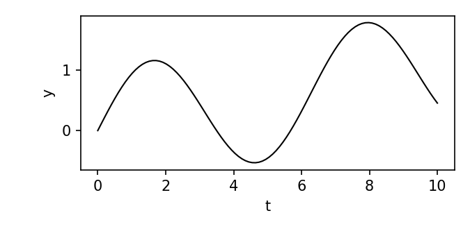

# Mathematics

Inline: the exogeneity condition is $E[u \mid X] = 0$, and the elasticity of
output with respect to capital is $\alpha$. A second sentence follows, long
enough to wrap onto several lines so that justification and hyphenation can be judged.

Display, a Cobb–Douglas production function:

$$
Y = AK^\alpha L^\beta
$$

A longer equation, to check horizontal scrolling on a phone:

$$
\hat{\beta}_{OLS} = (X'X)^{-1}X'y = \beta + (X'X)^{-1}X'u, \qquad \operatorname{Var}(\hat{\beta} \mid X) = \sigma^2 (X'X)^{-1}
$$

## Prose

Body text with a footnote.[^1] This paragraph is followed by another one, to
check the LaTeX-style indent and the numerals in 1973, 2008 and 2020.

A second paragraph. It should be indented, with no gap before it, as in a
journal article.

> A quotation, indented on both sides and set upright.

### A table

| Variable | Mean | Std. dev. |
|----------|-----:|----------:|
| Wage     | 12.4 |       5.1 |
| Schooling | 9.8 |       3.2 |

#### Code

Inline `lm(y ~ x)` and a block:

```r
fit <- lm(wage ~ schooling, data = df)
summary(fit)
```

[^1]: A footnote, to check its styling at the bottom of the page.
# Introduction

The Fisher equation states that $i_t = r_t + \mathbb{E}_t[\pi_{t+1}]$. This paragraph is long enough to show justification, hyphenation and the typical rhythm of a LaTeX article, with *italics*, **bold**, `inline code`, a [link](https://example.com), a citation [@fisher1930] and a cross-reference to @eq-vecm and @tbl-results.[^1]

Second paragraph, indented as in LaTeX. Inline math: $\Delta y_t = \Pi y_{t-1} + \sum_{j=1}^{p-1}\Gamma_j \Delta y_{t-j} + \varepsilon_t$.

$$
\Delta y_t = \alpha\beta' y_{t-1} + \sum_{j=1}^{p-1}\Gamma_j \Delta y_{t-j} + \varepsilon_t
$$ {#eq-vecm}

$$
\int_{-\infty}^{\infty} e^{-x^2}\,dx = \sqrt{\pi} \tag{2}
$$

## Data

| Variable | Mean | SD | N |
|:---------|-----:|---:|--:|
| Policy rate | 6.21 | 2.10 | 240 |
| Inflation | 5.34 | 2.87 | 240 |
| TRM | 2,845.1 | 612.4 | 240 |

: Summary statistics {#tbl-results}

### Subsection

- First item
- Second item
  - Nested item
1. One
2. Two
   1. Nested

> A quotation set in the quote environment of LaTeX.

```python
import numpy as np
x = np.arange(10)
print(x.mean())
```

::: {#thm-main}
## Main result
Let $y_t$ be $I(1)$. Then there exists a cointegrating vector $\beta$.
:::

::: {.proof}
Trivial.
:::

::: {.callout-note}
A callout.
:::

{#fig-a}

# References {.unnumbered}

::: {#refs}
:::

[^1]: A footnote at the end of the document.
